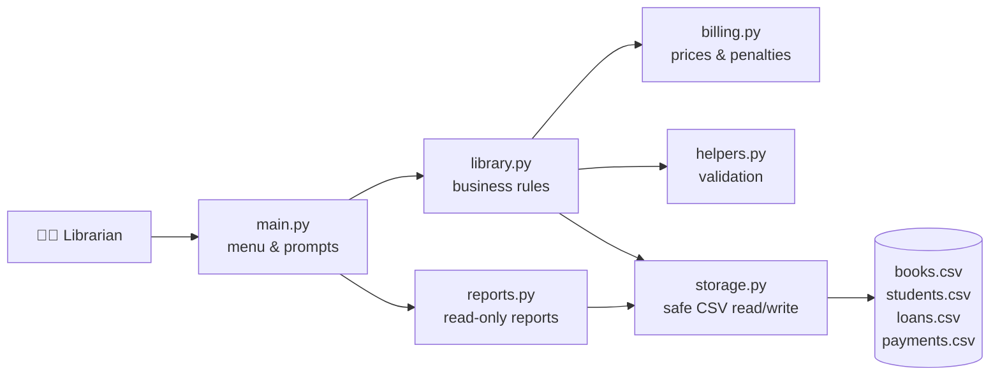
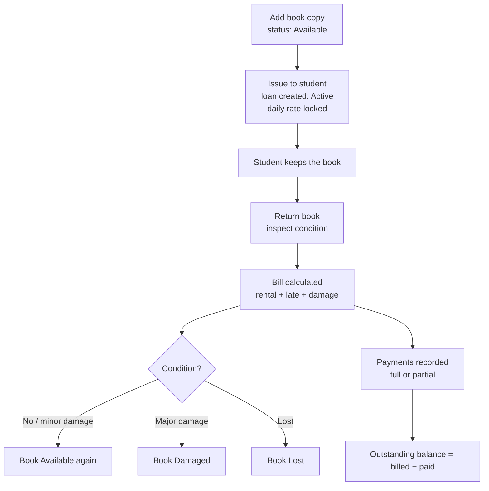

<div align="center">

# 📚 Library Rental Management System

### *Lend books. Bill them fairly. Never lose a record.*

A beginner-friendly, terminal-based **book rental and billing system** written in pure Python.
No database server. No paid APIs. No external packages. Just Python and CSV files.


</div>

---

## ✨ What it does

| 📖 Books | 🎓 Students | 🔄 Loans | 💰 Money |
|---|---|---|---|
| Every physical copy has its own ID | Register with ID, name, contact | Issue with a printed receipt | Daily rate = base + margin |
| Multiple copies of one title | Search by ID or name | Return with an itemised bill | Late and damage penalties |
| Search by ID, title, author, category | See books each student holds | Locked price per loan | Partial payments supported |
| Mark damaged / lost / under repair | Full borrowing + payment history | Overdue tracking | Billed vs. paid vs. outstanding |

---

## 🧠 How it works (the big picture)



**Each file has one job:**

| File | Role |
|---|---|
| `main.py` | The menu. Asks questions, prints results. Contains no business rules. |
| `library.py` | The brain: add books, register students, issue, return, take payments. |
| `billing.py` | **All** money rules and settings in one place. Change a number here, the whole app follows. |
| `reports.py` | Inventory, overdue, income and history reports. Never changes any data. |
| `storage.py` | The only file that touches the CSVs: safe saving, corruption checks, backups. |
| `helpers.py` | Validation for prices, dates, IDs, percentages and table printing. |
| `test_library.py` | 44 automatic tests that run on temporary data. |

### 🔁 The life of one book



### 🧩 Three design ideas worth knowing

1. **"Issued" is never typed in by hand.** A copy is issued only if it has an *Active* loan. Counts on the dashboard are calculated from the records, so they can never disagree with them.
2. **Prices are locked at issue time.** The daily rate is copied into the loan. Changing a book's price later never changes loans already out.
3. **Billed ≠ Collected.** Unpaid charges are never counted as income. Reports show *billed*, *collected* and *outstanding* separately.

---

## 🧮 Billing formulas

```text
Final daily rate = Base daily rate × (1 + Margin % / 100)
Chargeable days  = (Return date − Issue date) + 1        ← both days count
Late days        = max(0, Return date − Due date)
Rental charge    = Final daily rate × Chargeable days
Late penalty     = Late days × Final daily rate × 10%
Damage penalty   = Purchase cost × Damage %
TOTAL DUE        = Rental charge + Late penalty + Damage penalty
```

| Condition on return | Damage penalty | Book becomes |
|---|---|---|
| No damage | 0% of purchase cost | Available |
| Minor tears or markings | 10% | Available (noted *Minor damage*) |
| Major tearing / damaged binding | 30% | Damaged |
| Lost or unusable | 100% | Lost |

### Worked example

> Base rate ₹20 · Margin 10% → **Final rate ₹22/day** · Purchase cost ₹500
> Issued 1 Jan, due 5 Jan, returned 6 Jan · Minor damage

| Item | Calculation | Amount |
|---|---|---|
| Rental charge | ₹22 × 6 days | ₹132.00 |
| Late penalty | 1 day × ₹22 × 10% | ₹2.20 |
| Damage penalty | 10% × ₹500 | ₹50.00 |
| **Total** | | **₹184.20** |

> ⚠️ **Margin is not profit.** The margin is a markup added to the base rate to set the price. Real net profit is money collected *minus* the library's costs (book purchases, repairs, rent, salaries), which this app does not track.
> The **10% late fee** is separate from the **10% margin**.

All money uses Python's `decimal.Decimal` (no floating-point surprises) and is rounded to 2 decimal places.

---

## 🚀 Getting started

### 1️⃣ Clone this repository

You need [Python 3.8+](https://www.python.org/downloads/) and [Git](https://git-scm.com/downloads) installed. Check with:

```bash
python --version
git --version
```

Then clone and enter the project:

```bash
git clone https://github.com/<your-username>/LibraryManagementSystem.git
cd LibraryManagementSystem
```

> Replace `<your-username>` with your GitHub username. Prefer SSH? Use
> `git clone git@github.com:<your-username>/LibraryManagementSystem.git`

**Or in VS Code:** press `Ctrl+Shift+P` → **Git: Clone** → paste the repository URL → choose a folder → **Open**.

### 2️⃣ Run it

```bash
python main.py
```

On macOS/Linux you may need `python3 main.py`. There is **nothing to install**.
The four CSV files and a `backups/` folder are created automatically on first run.

### 3️⃣ Run the tests

```bash
python -m unittest -v
```

Tests use a temporary folder, so your real library records are never touched.

---

## 🖥️ Using the app

```text
============================================
   LIBRARY RENTAL MANAGEMENT SYSTEM
============================================
  1. Add New Book                 10. View Overdue Books
  2. View All Books               11. View Damaged or Lost Books
  3. Search Book                  12. View Loan and Payment History
  4. Check Available Books        13. Record Payment
  5. Register Student             14. View Inventory Summary
  6. View Students                15. View Income Report
  7. Issue Book                   16. Update Book Details
  8. Return Book                  17. Exit
  9. View Active Loans
```

💡 Type `cancel` at any prompt to go back to the menu without changing anything.

### Suggested first run

1. **Option 1** → add a book, e.g. cost `500`, base rate `20`, press Enter for the default 10% margin, `2` copies.
2. **Option 5** → register student `S001`.
3. **Option 7** → issue `B0001` to `S001`.
4. **Option 8** → return it, pick a condition, check the itemised bill, confirm.
5. **Option 13** → record a (partial) payment.
6. **Options 14 & 15** → view the inventory summary and income report.

### Sample return bill

```text
============================================================
                       RETURN BILL
============================================================
Loan ID     : L0001
Book        : B0001 - Python Basics
Student     : S001 - Asha Kumar
Issued      : 2026-10-10    Due: 2026-10-17
------------------------------------------------------------
Daily rate (locked at issue)              : ₹22.00
Chargeable days (issue + return day)      : 11
Rental charge = ₹22.00 x 11               : ₹242.00
Late days                                 : 3
Late penalty = 3 x ₹22.00 x 10%           : ₹6.60
Damage category                           : Minor tears or markings
Damage penalty = 10% of ₹500.00           : ₹50.00
------------------------------------------------------------
TOTAL AMOUNT DUE                          : ₹298.60
============================================================
```

---

## ⚙️ Configuration

Everything adjustable lives in **`billing.py`**:

```python
SETTINGS = {
    "loan_period_days": 7,                    # how long a book may be kept
    "default_margin_percent": Decimal("10"),  # markup on the base rate
    "late_fee_percent": Decimal("10"),        # % of daily rate per late day
}
```

The damage categories and their percentages are in `DAMAGE_CATEGORIES` in the same file.

---

## 🗂️ Project structure

```text
LibraryManagementSystem/
├── main.py            # menu and user interface
├── library.py         # books, students, loans, payments
├── billing.py         # pricing rules and settings
├── reports.py         # inventory and financial reports
├── storage.py         # safe CSV reading, writing and backups
├── helpers.py         # validation and formatting
├── test_library.py    # automatic tests
├── README.md
├── .gitignore
│
├── books.csv          # ┐
├── students.csv       # │ created automatically on first run
├── loans.csv          # │ (ignored by Git: private data)
├── payments.csv       # ┘
└── backups/           # timestamped copies, newest 10 kept
```

## 📄 CSV files

| File | Columns |
|---|---|
| `books.csv` | `book_id, title, author, category, publisher, purchase_cost, base_daily_rate, margin_percent, daily_rate, condition, status` |
| `students.csv` | `student_id, name, contact_number, registration_date` |
| `loans.csv` | `loan_id, book_id, student_id, issue_date, due_date, return_date, daily_rate_at_issue, chargeable_days, late_days, rental_charge, late_penalty, damage_category, damage_penalty, total_amount_due, loan_status` |
| `payments.csv` | `payment_id, loan_id, payment_date, amount, payment_method, reference_number` |

Amounts are stored as plain numbers (`22.00`), never with currency symbols. Dates use `YYYY-MM-DD`.

---

## 🛡️ Data safety

- ✅ Unique IDs for books, students, loans and payments
- ✅ Validated dates, prices, percentages and quantities (no negatives, no future dates)
- ✅ Safe saving: data is written to a temporary file, then swapped in, so a crash can't half-write a CSV
- ✅ Damaged or malformed CSV files give a clear error instead of a crash
- ✅ Missing CSV files are recreated automatically
- ✅ A backup of all CSVs is taken every time the app starts
- ✅ No duplicate returns, no duplicate book IDs, no issuing unavailable books
- ✅ Payments can never exceed the outstanding balance

> ⚠️ **Single librarian only.** CSV files have no transactions or locking. Run **one** copy of the app at a time, and close the CSVs in Excel before using the app.

---

## 🧪 Testing

`test_library.py` covers: adding/searching books, multiple copies, duplicate IDs, issuing available / unavailable / damaged / lost copies, on-time and late returns, the ₹184.20 example, every damage category, partial payments, overpayment rejection, invalid dates and negative prices, missing and malformed CSVs, reopening without data loss, and inventory counts matching loan records.

---

## 📸 Screenshots

> Add your own after running the app, for example:
>
> ```md
> 
> 
> 
> ```

---

## 🔭 Future improvements

- 🖼️ Tkinter graphical interface
- 🗄️ SQLite database (real transactions, multiple users)
- 🔐 Librarian login system
- 🧾 Printable / PDF receipts
- 📱 SMS or email reminders for overdue books
- 💸 Refund and credit policy
- 📊 Charts and exportable monthly reports
- 📥 CSV import for adding many books at once

---

## 🤝 Contributing

1. Fork the repository
2. Create a branch: `git checkout -b feature/my-idea`
3. Run the tests: `python -m unittest`
4. Commit and push, then open a pull request

## 📝 Suggested first commits

```bash
git init
git add .
git commit -m "Add CSV storage layer with safe writes and backups"
git commit --allow-empty -m "Add book inventory and student registration"
```

Or simply upload everything in one go:

```bash
git init
git add .
git commit -m "Initial commit: Library Rental Management System"
git branch -M main
git remote add origin https://github.com/<your-username>/LibraryManagementSystem.git
git push -u origin main
```

---

<div align="center">

Built with 🐍 Python while learning, one function at a time.

⭐ If this project helped you, give it a star!

</div>
